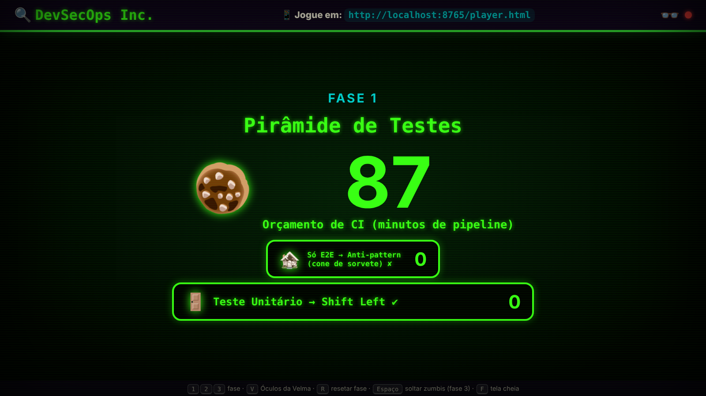
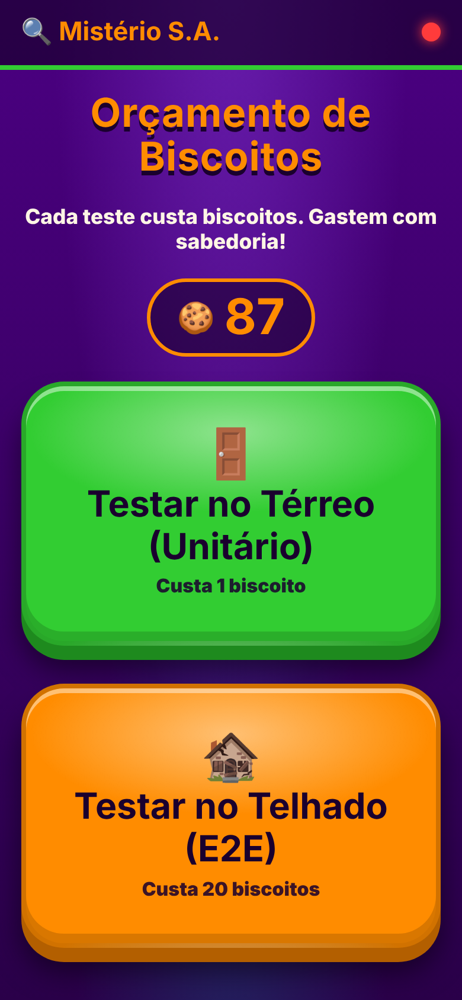
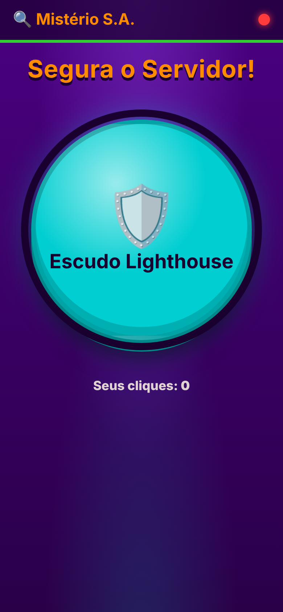
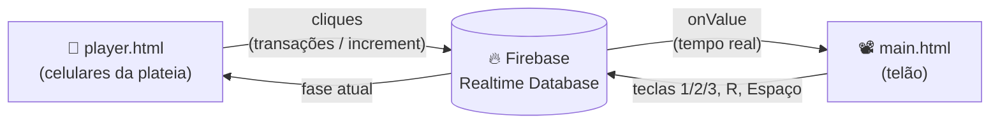

# 🔍 Mistério S.A. — um jogo multiplayer sobre DevSecOps

Jogo interativo para palestras: a plateia joga pelo **celular** e o resultado aparece em **tempo real no telão**. Os conceitos de DevSecOps (pirâmide de testes, TDD, performance, testes de aceitação) são apresentados com uma temática de desenho animado de detetives — e, ao apertar **V**, o **Óculos da Velma** revela o significado técnico por trás de cada analogia.

<p align="center">
  <br>
  
  
</p>

- **Sem frameworks, sem build:** HTML, CSS e JavaScript puro (ES Modules).
- **Tempo real:** sincronização via [Firebase Realtime Database](https://firebase.google.com/docs/database).
- **Fácil de personalizar:** todos os textos e o balanceamento ficam em um único arquivo (`config.js`).

---

## Sumário

- [Como funciona](#como-funciona)
- [Rodando no seu computador](#rodando-no-seu-computador)
- [Controles do apresentador](#controles-do-apresentador)
- [As fases](#as-fases)
- [Estrutura do projeto](#estrutura-do-projeto)
- [Personalizando](#personalizando)
- [Publicando na internet](#publicando-na-internet)
- [Segurança](#segurança)
- [Solução de problemas](#solução-de-problemas)
- [Ideias de melhoria](#ideias-de-melhoria)
- [Contribuindo](#contribuindo)

---

## Como funciona



- **`main.html` (telão)** escuta o banco e transforma cada mudança em animação. Também é quem controla a fase atual e roda a simulação de latência da fase 3.
- **`player.html` (celular)** só envia comandos. A tela troca sozinha quando o apresentador muda de fase.

---

## Rodando no seu computador

### Pré-requisitos

- Uma conta Google (para o Firebase — o plano gratuito *Spark* é suficiente).
- Um servidor estático local. Qualquer um destes serve:
  - **VS Code + extensão [Live Server](https://marketplace.visualstudio.com/items?itemName=ritwickdey.LiveServer)** (recomendado — o VS Code vai sugerir a instalação ao abrir a pasta);
  - `npx serve .` (precisa de Node.js);
  - `python3 -m http.server 5500`.

> ⚠️ Abrir o `index.html` com duplo clique (`file://`) **não funciona**: navegadores bloqueiam ES Modules fora de um servidor HTTP.

### 1. Crie o banco no Firebase

1. Acesse o [Firebase Console](https://console.firebase.google.com/) e crie um projeto (o Google Analytics pode ficar desligado).
2. Em **Build → Realtime Database**, clique em **Criar banco de dados**. Escolha a região e comece em **modo de teste**.
3. Em **Configurações do projeto (⚙️) → Seus apps**, adicione um **App da Web** (`</>`). Não precisa de Firebase Hosting por enquanto.
4. Copie o objeto `firebaseConfig` que aparece na tela.

### 2. Configure as credenciais

Cole os valores em [`firebase-config.js`](firebase-config.js). Confira se o campo `databaseURL` está preenchido — ele é obrigatório para o Realtime Database.

Para **não enviar suas credenciais ao repositório por engano**, rode uma vez:

```bash
git update-index --skip-worktree firebase-config.js
```

(Para desfazer: `git update-index --no-skip-worktree firebase-config.js`.)

### 3. Suba o servidor

Com o Live Server: clique em **Go Live** na barra inferior do VS Code. A pasta `.vscode/` do projeto já configura o servidor para aceitar conexões de outros aparelhos da rede.

Abra `http://localhost:5500` e entre na **Tela do Projetor**. Na primeira abertura, ela cria a estrutura inicial do banco automaticamente.

### 4. Conecte os celulares

Os celulares precisam estar **na mesma rede Wi-Fi** do computador e acessar o **IP da máquina**, não `localhost`:

```
http://192.168.0.10:5500/player.html
```

Para descobrir seu IP: `ipconfig` (Windows) ou `ipconfig getifaddr en0` (macOS) ou `hostname -I` (Linux).

A URL para a plateia aparece no topo do telão. Para fixá-la (por exemplo, quando o telão roda em `localhost`), preencha `playerUrl` em `config.js`.

> 💡 Em eventos, redes Wi-Fi corporativas costumam isolar os aparelhos entre si. Para não depender disso, [publique o jogo na internet](#publicando-na-internet) antes da apresentação.

---

## Controles do apresentador

Na tela do projetor (`main.html`):

| Tecla | Ação |
|---|---|
| `1` `2` `3` | Muda a fase (todos os celulares acompanham) |
| `V` | Liga/desliga o **Óculos da Velma** (só no telão) |
| `R` | Reseta os dados da fase atual |
| `Espaço` | Fase 3: solta os zumbis (inicia a contagem de 10 s) |
| `F` | Tela cheia |

A bolinha no canto superior direito mostra a conexão com o Firebase (🟢 conectado / 🔴 desconectado).

---

## As fases

| Fase | Analogia (desenho) | Conceito real (Óculos da Velma) | Mecânica |
|---|---|---|---|
| **1. Orçamento de Biscoitos** | Testar no térreo custa 1 biscoito, no telhado custa 20 | Pirâmide de testes: unitários (*shift left*) × só E2E (*anti-pattern*) | A plateia gasta um orçamento compartilhado. Com a Velma, o prédio vira uma pirâmide. |
| **2. A Armadilha do Fred** | Montar a armadilha na ordem certa | TDD (Red → Green → Refactor) e *Definition of Done* | Botões RED, GREEN, REFACTOR em ordem. Pular etapa faz a tela tremer. |
| **3. Segura o Servidor** | 10.000 zumbis e um escudo | Teste de carga, latência p99 e teste de aceitação | *Button mashing* para manter a latência baixa por 10 s; depois, puxar a máscara revela o **Código Espaguete**. |

---

## Estrutura do projeto

```
.
├── index.html           # Landing page com links para telão e celular
├── main.html / main.js  # Tela do projetor: escuta o banco, anima, lê o teclado
├── player.html / player.js  # Tela do celular: envia comandos
├── config.js            # ✏️ Textos, analogias e balanceamento
├── firebase-config.js   # 🔑 Credenciais do Firebase
├── imagens.js           # Troca  inexistentes por emojis
├── styles.css           # Tema visual, Óculos da Velma e animações
├── img/                 # 🖼️ Suas imagens (ver img/LEIA-ME.txt)
├── database.rules.json  # Regras de segurança do banco
├── firebase.json        # Configuração do Firebase Hosting
└── docs/                # Capturas de tela do README
```

### Modelo de dados

```jsonc
{
  "gameState": { "currentPhase": 1 },          // 1, 2 ou 3 — escrito pelo telão
  "phase1": { "biscoitos": 100, "unitarios": 0, "e2e": 0 },
  "phase2": { "step": 0, "errors": 0 },        // step: 0 início, 1 red, 2 green, 3 refactor
  "phase3": {
    "stage": "waiting",                        // waiting | running | mask | unmasked | failed
    "shieldPower": 0,                          // total de cliques no escudo
    "maskPulled": false
  }
}
```

**Decisões importantes:**

- **Transações** (`runTransaction`) nas fases 1 e 2: com dezenas de pessoas clicando ao mesmo tempo, garantem que nenhum clique se perca, que o saldo de biscoitos não fique negativo e que a ordem do TDD seja validada sem condições de corrida.
- **`increment()` em lotes** na fase 3: o celular junta os toques e envia a cada 250 ms, reduzindo o tráfego sem perder a contagem.
- **O telão é a fonte da verdade** do tempo e da barra de latência na fase 3. Os celulares só enviam cliques.

---

## Personalizando

### Textos e piadas → `config.js`

Todo par `{ desenho, real }` vira uma analogia: `desenho` aparece normalmente e `real` aparece com o Óculos da Velma.

```js
terreo: { desenho: 'Testar no Térreo (Unitário)', real: 'Teste Unitário → Shift Left ✔' },
```

No HTML, basta marcar o elemento com `data-analogia="caminho.no.config"` (telão) ou `data-texto="caminho.no.config"` (celular).

### Dificuldade da fase 3 → `config.js` → `fase3`

| Campo | Efeito |
|---|---|
| `duracaoSegundos` | Quanto tempo a plateia precisa sobreviver |
| `subidaPorSegundo` / `aceleracao` | Velocidade com que a latência sobe |
| `reducaoPorClique` | Quanto cada toque abaixa a barra |

Regra de bolso: são necessários cerca de `75 / reducaoPorClique` cliques no total. Plateia pequena (~10 pessoas) → `0.3`; auditório grande (100+) → `0.04`.

### Imagens → pasta `img/`

Coloque arquivos com os nomes listados em [`img/LEIA-ME.txt`](img/LEIA-ME.txt). Enquanto uma imagem não existir, o jogo mostra um emoji no lugar. O filtro de raio-X do Óculos da Velma também é aplicado às suas imagens.

### Visual → `styles.css`

As cores ficam em variáveis no topo do arquivo (`--roxo`, `--lima`, `--abobora`, `--turquesa`). O tamanho de cada imagem é controlado por `--tam`.

---

## Publicando na internet

O jogo é estático, então qualquer hospedagem funciona (Firebase Hosting, GitHub Pages, Netlify, Vercel…). Com o **Firebase Hosting**, já configurado em `firebase.json`:

```bash
npm install -g firebase-tools
firebase login
firebase use --add            # escolha o seu projeto
firebase deploy               # publica o site e as regras do banco
```

O jogo fica em `https://SEU-PROJETO.web.app` e os celulares acessam `https://SEU-PROJETO.web.app/player.html`.

---

## Segurança

Este é um projeto sobre DevSecOps, então vale dar o exemplo. 🙂

- **A configuração web do Firebase não é secreta** — ela fica visível no navegador de qualquer jogador. A proteção de verdade vem das **regras do banco**.
- O **modo de teste** deixa o banco aberto para leitura e escrita por qualquer pessoa e expira em 30 dias. Use-o só para desenvolver.
- O arquivo [`database.rules.json`](database.rules.json) traz regras que **validam o formato** de cada campo e bloqueiam caminhos desconhecidos. Publique-as com `firebase deploy --only database` ou cole-as em **Realtime Database → Regras**.
- Mesmo com essas regras, qualquer pessoa com a URL ainda consegue escrever valores válidos (por exemplo, trocar de fase). Para uma palestra é aceitável. Para mais proteção, veja [Ideias de melhoria](#ideias-de-melhoria).
- Depois do evento, **desative ou exclua o banco**.

---

## Solução de problemas

| Sintoma | Causa provável |
|---|---|
| Tela "Falta configurar o Firebase" | `firebase-config.js` ainda tem os valores de exemplo. |
| Página em branco e erro de CORS/módulo no console | Arquivo aberto via `file://`. Use um servidor local. |
| Bolinha vermelha no topo | Sem conexão com o Firebase: confira `databaseURL`, a internet e se o banco foi criado. |
| `PERMISSION_DENIED` no console | As regras do banco bloquearam a escrita: o modo de teste expirou ou as regras foram alteradas. |
| Celular não abre a página | Celular em outra rede, uso de `localhost` em vez do IP, firewall do computador ou Wi-Fi com isolamento de clientes. |
| Fase 3 fácil ou difícil demais | Ajuste `reducaoPorClique` em `config.js`. |
| Teclas não funcionam no telão | Clique uma vez na página do projetor para que ela receba o foco. |

---

## Ideias de melhoria

Boas oportunidades para contribuir:

**Segurança**
- [ ] Login anônimo (Firebase Authentication) e regras que só deixam o apresentador mudar de fase e resetar.
- [ ] Firebase App Check para dificultar scripts automatizados.
- [ ] Limite de taxa de cliques por jogador.

**Jogo**
- [ ] Nova fase sobre **segurança**: SAST/DAST, gestão de segredos ou dependências vulneráveis (ex.: "o fantasma da biblioteca desatualizada").
- [ ] Contador de jogadores conectados (com `onDisconnect`).
- [ ] Placar final e ranking de quem mais clicou.
- [ ] QR Code no telão para a plateia entrar mais rápido.
- [ ] Efeitos sonoros (com botão de mudo).
- [ ] Botão de controle no celular do apresentador, para não depender do teclado.

**Código e qualidade**
- [ ] Testes automatizados (ex.: Playwright com o Firebase Emulator Suite).
- [ ] Pipeline de CI com lint (ESLint, Stylelint) e deploy automático — o próprio jogo praticando DevSecOps.
- [ ] Tradução para outros idiomas a partir do `config.js`.
- [ ] Revisão de acessibilidade (contraste, leitores de tela, navegação por teclado no celular).

---

## Contribuindo

Contribuições são bem-vindas! Leia o [CONTRIBUTING.md](CONTRIBUTING.md) para saber como rodar o projeto, o padrão de código e como abrir um pull request.

## Créditos e direitos autorais

Este é um projeto educacional e não oficial, sem relação com os detentores da marca *Scooby-Doo*. Personagens, nomes e imagens oficiais pertencem aos seus respectivos donos. **Não envie imagens protegidas por direitos autorais para o repositório** — use ilustrações próprias, com licença livre ou os emojis de reserva.

## Licença

<!-- Escolha uma licença antes de publicar (ex.: MIT) e adicione o arquivo LICENSE. -->
Ainda não definida. Veja [choosealicense.com](https://choosealicense.com/) para escolher uma.
